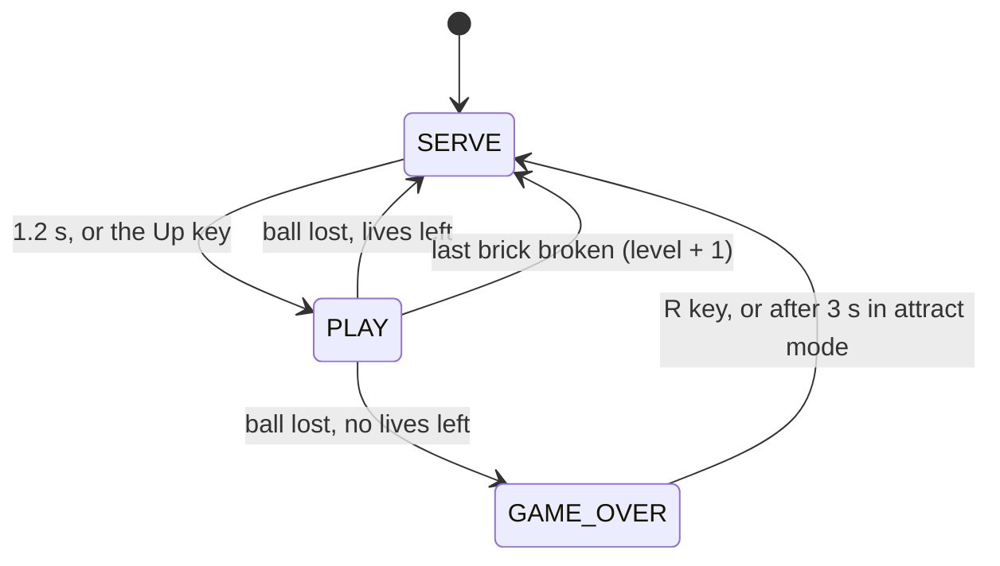
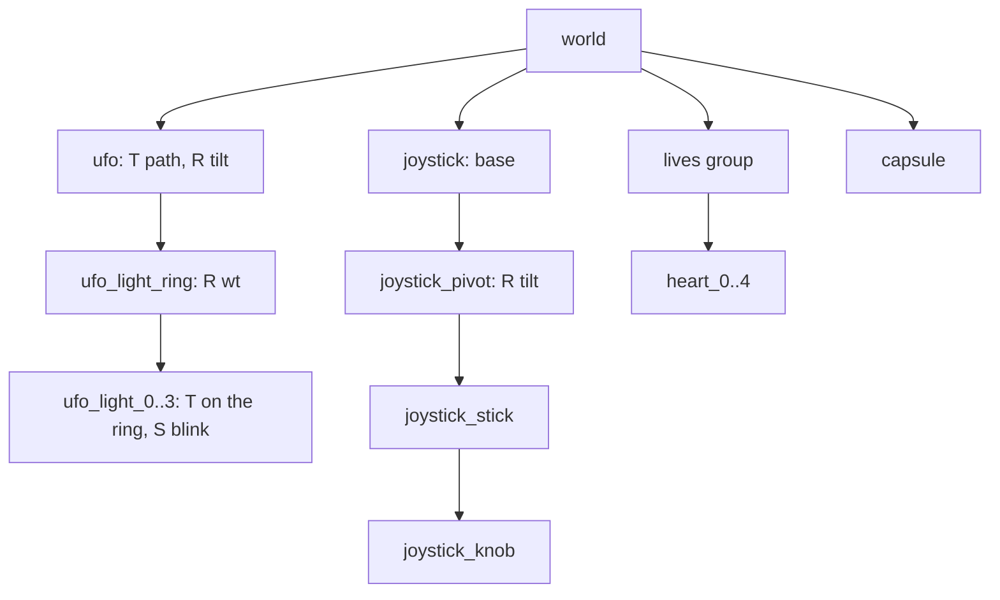

# Gameplay and 2D animation (Member 3)

This explains `game.py`, `anim2d.py` and `persist.py`: the Breakout rules, the 2D
animation and save / load. Read it with [HOW_IT_WORKS.md](HOW_IT_WORKS.md) (the engine)
before the Q&A.

## The 30-second version

> `game.py` holds the whole game as **plain numbers in world units** and never calls
> OpenGL. Every frame `update(dt)` moves the ball in **small sub-steps**, bounces it with
> the reflection formula `v' = v - 2(v·n)n`, and runs the rules: score, lives, levels,
> the UFO on its **curved path** and the **power-up capsules** it drops.
> `anim2d.py` then copies those numbers into the **T · R · S** of the 2D scene-graph
> nodes, so every object moves, turns or grows, and children such as the UFO's lights
> and the joystick knob follow their parents through the scene graph.

## Files

| File | Job |
|---|---|
| `game.py` | Game state and rules, `update(dt)`, collisions, attract-mode AI. No OpenGL. |
| `anim2d.py` | `sync(root, game, dt)`: game numbers → node transforms. `ensure_nodes(root)`: default joystick, capsule and hearts. No OpenGL. |
| `persist.py` | Settings as JSON (save, load, check), screenshots with `glReadPixels` + Pillow. |
| small hooks | `render2d.sync` calls `anim2d.sync`; `main.py` shows game events and has Save / Load / Screenshot; `gui.py` has the buttons, keys and the score in the status bar. |

## One call of `game.update(dt)`

`dt` is already multiplied by the speed slider. When paused, `update` is not called.

```
1. power-up timers      wide paddle / slow ball count down, the paddle width eases to its target
2. paddle               arrow keys (or attract-mode AI) x 12 units/s, kept inside the walls
3. joystick             leans towards the paddle's movement (eases, does not jump)
4. UFO                  position and heading from its path at time t, light ring turns
5. ball                 SERVE: rides on the paddle | PLAY: sub-steps with collisions | GAME_OVER: waits
6. capsule              falls, spins, caught by the paddle or lost
7. animations           bricks break / pop in, score pulse, popping heart, paddle dip
```

## The game as a state machine



| Rule | Value |
|---|---|
| Brick | 10 points (50 bricks, 5 rows x 10) |
| UFO hit | 50 points, the UFO wobbles and drops a capsule |
| Capsule caught | 25 points plus its power-up |
| Wide paddle (blue) | paddle 1.6 x wider for 10 s |
| Slow ball (green) | ball at 65 % speed for 8 s |
| Extra life (pink) | +1 life, at most 5 |
| Lives | 3 at the start |
| New level | new wall of bricks, ball 10 % faster per level |
| Capsules | the UFO also drops one every 18 s of play |

## Ball physics

### Sub-steps: the ball never jumps through a brick

At the fastest settings (ball speed 15, speed slider 3x, frame time capped at 0.1 s) the
ball moves **4.5 units in one frame**, while a brick is only 0.6 tall. So each frame is
cut into `n = ceil(distance / (r / 2))` steps of at most half a ball radius (0.15 units),
and collisions are checked after every step. The test `test_fast_ball_does_not_tunnel_through_a_brick` checks this.

### Circle against rectangle

Everything the ball hits (walls, paddle, bricks, UFO) is a rectangle. `circle_rect_contact`:

1. Clamp the ball's centre into the rectangle. That gives the **closest point** of the rectangle.
2. If that point is nearer than the radius `r`, they touch.
3. The **normal** `n` is the unit vector from the closest point to the centre. A flat side gives
   `(0, 1)`, `(1, 0)`, …; a corner gives a diagonal normal, so corner hits look natural.
4. `depth = r - distance` is how far the ball is inside; we push it out by `depth · n`.

### Reflection

```
v' = v - 2 (v · n) n          only when v · n < 0 (the ball moves INTO the surface)
```

Worked example: the ball moves with `v = (4, -3)` and hits the top of the paddle, `n = (0, 1)`.
`v · n = -3`, so `v' = (4, -3) - 2(-3)(0, 1) = (4, 3)`. Only the part along the normal flips.

After a corner hit the ball could fly almost flat and bounce from wall to wall for ever,
so `|vy|` is kept at least 30 % of the speed.

### Paddle angle: how the player aims

The top of the paddle does not reflect like a mirror. Where the ball lands decides the angle:

```
offset = (ball_x - paddle_x) / half_width        -1 (left edge) .. 0 (centre) .. +1 (right edge)
angle  = offset x 60 deg                          from vertical
v'     = speed x (sin angle, cos angle)
```

Centre → straight up, right edge → 60° to the right (test `test_paddle_centre_sends_ball_up_and_edge_at_60_degrees`).

### Bricks: only test the ones nearby

The bricks sit on a grid, so the ball's row and column come straight from its position:
`col = round((x + 9) / 2.0)`, `row = round((5 - y) / 0.85)`. Only those bricks and their
neighbours (at most 9) are tested instead of all 50. If several touch, the deepest overlap
is the real hit, and one brick breaks per sub-step.

## The UFO: a curved path, facing its direction of motion

```
x(t) = 12 sin(w t)                 w = 2 pi / 16 s     (it turns round just off the screen)
y(x) = 6.45 + 0.4 sin(k x)         k = 2 pi / 8        (a wave across the sky)

vx = 12 w cos(w t)
vy = dy/dt = 0.4 k cos(k x) · vx   (chain rule)
heading = atan2(vy, vx)
```

The velocity is the **exact derivative**, so the heading is the same at any frame rate
(test `test_ufo_faces_its_direction` compares it with a finite difference of the path).

The saucer is symmetric left-right, so flying left it should not turn upside down:
`upright_tilt` maps a heading near 180° to a small tilt (for example 170° → -10°). The body's
long axis still lies exactly along the path. Because `y` depends on `x`, the slope is at
most `0.4 k = 0.31`, so the tilt never goes past about 17°.

## Attract mode (M key)

The paddle plays by itself at the normal paddle speed (no cheating):

1. **Predict** where the ball reaches the paddle: follow the straight line, then fold it
   between the side walls like a strip of paper (`fold_between`). Example: a ball that would
   reach `x = 11` bounces off the wall at 9.7 and arrives at `9.7 - 1.3 = 8.4`.
2. **Aim**: stand so the ball lands on the part of the paddle that sends it towards the lowest
   brick of the column with the most bricks left (the paddle-angle formula backwards).
3. While the ball goes up, it moves under a falling capsule to catch it.

In tests it plays two minutes without losing a life.

## The 2D animation (`anim2d.py`)

Every frame `sync` writes the game's numbers into each node's local `T · R · S`.
Read every plan right to left: scale first, then rotate, then move.

| Object | T (move) | R (turn) | S (scale) | Transformation plan |
|---|---|---|---|---|
| ball | its path | rolls: `-distance / r` | – | `T(x, y) · R(spin)` |
| paddle | keys / AI, dips 0.12 on a hit | – | width = slider x power-up, eases | `T(px, -6.5 - 0.12 dip) · S(w, 1)` |
| breaking brick (0.45 s) | falls `1.5 p²` | spins `±180 p` | shrinks `1 - p` | `T(bx, by - 1.5p²) · R(±180p) · S(1 - p)` |
| new-level brick | – | – | pops in with an overshoot | `T(bx, by) · S(ease_out_back(p))` |
| UFO | wave path | tilts along the path | (GUI size) | `T(x(t), y(t)) · R(tilt) · S(size)` |
| UFO light ring | – | orbits, `ω t` | – | `R(ω t)` |
| UFO light i | 1 unit from the centre | – | blinks in turn | `T(cos 90i, sin 90i) · S(blink)` |
| capsule | falls 3 units/s | spins 180°/s | pulses | `T(cx, cy - 3t) · R(180t) · S(1 + 0.12 sin 10t)` |
| joystick pivot | – | leans ±25° with the paddle | – | `T(0, 0.1) · R(tilt)` |
| heart i | – | – | beats; the lost one pops | `T(hx, hy) · S(beat)` |

`p` is the progress of the animation from 0 to 1.

### Hierarchical motion



```
world(light_i) = T(ufo) · R(tilt) · S(size) · R(ω t) · T(cos 90i, sin 90i) · S(blink)
world(knob)    = T(base) · T(0, 0.1) · R(tilt) · T(0, 0.2) · T(0, 0.2)
```

The **pivot** node is the joint: rotating it turns the stick about its bottom end instead of
its centre, and the knob comes along because it is the stick's child. Making the UFO bigger
with the Size slider makes the lights orbit on a bigger circle, because `S(size)` sits in
their chain too. Tests: `test_joystick_knob_follows_the_tilted_stick`,
`test_ufo_lights_ride_on_the_moving_ufo`.

### GUI edits are kept

A brick's transform is only written while it animates (and once when it settles), so the
Size, Rotation and Visible controls still work on idle bricks
(`test_gui_size_on_an_idle_brick_is_kept`). Values the animation drives, such as the ball's
rotation and the paddle's width, are listed in `anim2d.animated_fields()`.

### Node names (the contract with Member 2)

`sync` finds nodes by name and skips any that are missing. `ensure_nodes` only adds the
default joystick, capsule and hearts when the scene has no node with that name, so
Member 2 can draw nicer ones with the same names: `ball`, `paddle`, `bricks/brick_r_c`,
`ufo/ufo_light_ring/ufo_light_0..3`, `capsule`, `joystick/joystick_pivot/joystick_stick/joystick_knob`,
`lives/heart_0..4`, and `score` (scaled by `game.score_pulse` if it exists).

Useful extra numbers for the renderers: `game.banner` ("GET READY", "LEVEL 2", "GAME OVER"),
`game.score`, `game.lives`, `game.level`, `game.high_score`, `game.capsule_kind`, and
`game.bricks[r][c]` with `alive`, `visible`, `scale`, `angle`, `drop`, `alpha`. The 3D view can
read the same brick values to show the break animation in 3D.

## Save, load and screenshots (`persist.py`)

| Action | Keys / button | File |
|---|---|---|
| Save settings | Ctrl+S, Save | `code/settings.json` |
| Load settings | Ctrl+O, Load | `code/settings.json` |
| Screenshot | P, Screenshot | `code/screenshots/arcade_<date>_<time>.png` |

Both are in `.gitignore`. The settings file holds speed, view, game tuning, camera, best score,
and the colour, size, rotation and visibility of every node.

**Never crashes on a bad file.** `load_settings` refuses a missing, damaged or foreign file
with a clear message. `apply_settings` skips unknown objects and values of the wrong type, and
clamps numbers to the slider ranges. A file is written to `settings.json.tmp` and then renamed,
so it is never left half-written.

**Screenshot.** The canvas draws a fresh frame, `glReadPixels` copies the **back buffer**
before the swap, and the image is flipped (OpenGL's first row is the bottom of the picture,
a PNG's first row is the top).

## Tests (Member 3)

In `test_graphics.py`: `TestGame` (13), `TestAnimation2D` (4), `TestPersist` (3) — wall bounce,
brick +10, UFO heading, paddle angle, no tunnelling, life lost, game over, faster next level,
wide power-up, attract mode survives two minutes, bad `dt` ignored, circle-rectangle normals,
wall fold, joystick hierarchy, UFO lights on the ring, brick break animation, GUI size kept,
settings round trip, damaged files, clamping.

## Questions you might be asked

**Why sub-steps and not just a smaller `dt`?**
`dt` is the real frame time, which we do not control. Sub-steps split one frame into pieces
of at most half a ball radius, so even a 4.5-unit frame cannot jump over a 0.6-unit brick.

**How do you know which way the ball bounces?**
The normal from the closest point of the rectangle to the ball's centre. Then
`v' = v - 2(v·n)n` flips only the part of the velocity that goes into the surface.

**Why does the paddle not bounce like a mirror?**
So the player can aim: the landing point decides the angle (centre straight up, edges 60°).

**Where is the curved path, and how does the UFO face its direction?**
`x(t) = 12 sin(wt)`, `y = 6.45 + 0.4 sin(kx)`. The heading is `atan2(vy, vx)` of the exact
derivative, turned into an upright tilt so the saucer stays the right way up.

**Which motion is hierarchical?**
The UFO's lights (UFO → ring → lights) and the joystick (base → pivot → stick → knob). Only the
parents are animated; the children follow because `world = parent world · local`.

**Which objects use translation, rotation and scaling?**
A breaking brick uses all three at once: `T(fall) · R(spin) · S(shrink)`. The capsule does too.
The paddle uses T and S, the UFO T and R, the hearts S.

**Why does `game.py` have no OpenGL?**
So the same game drives the 2D and 3D views and can be tested without a window.

**What does `paddle_width` mean when the wide power-up is on?**
The slider writes the base width; the power-up multiplies it (`paddle_width = base x boost`).
The boost eases from 1 to 1.6 and back, so the paddle grows and shrinks smoothly, and the
slider keeps its own value.

**How does attract mode know where to go?**
It predicts the landing point by folding the straight path between the walls, then shifts the
paddle so the bounce angle points at the column with the most bricks.
