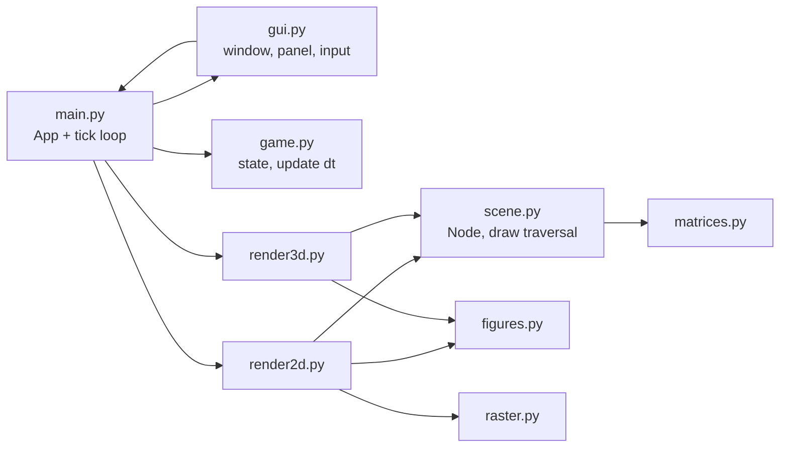

# How the engine works

This explains the parts every other module builds on: the matrices, the scene graph,
the animation loop and the GUI (Member 1). Read it before the Q&A. Every member
should be able to explain one function from each file.

## The 30-second version

> Every object is a **Node** in a **scene graph**. A node stores its figure in its own
> model coordinates (centred on the origin) and a **local transform** `T · R · S`.
> Its **world matrix** is `world(parent) · local(node)`, so children follow their
> parents. All matrices are **our own** 3×3 / 4×4 functions in `matrices.py`. OpenGL only
> gets the finished matrix through `glMultMatrixf`. A Tkinter `after()` loop runs about
> 60 times a second. It measures `dt`, lets `game.py` move the numbers, copies them onto
> the nodes and draws the 2D or 3D view into a double-buffered OpenGL canvas inside the Tk window.

## Files and who calls whom

| File | Owner | Job |
|---|---|---|
| `main.py` | M1 | Creates everything, runs the frame loop, holds pause / speed / view / selection |
| `matrices.py` | M1 | `identity3 translate2 scale2 rotate2 mul apply2 compose inverse2`, `identity4 translate3 scale3 rot_x rot_y rot_z apply3`, `to_gl` |
| `scene.py` | M1 | `Node` (`local`, `world`, `add`, `find`, `all_nodes`), `draw` traversal |
| `gui.py` | M1 | OpenGL canvas, control panel, status bar, matrix panel, keyboard and mouse |
| `test_graphics.py` | M1 + all | Unit tests, `python -m unittest` |
| `figures.py` | M2 / M4 | Vertex lists (2D) and vertex + face tables (3D) |
| `raster.py`, `render2d.py` | M2 | Course algorithms, drawing the 2D scene, click-to-select |
| `game.py`, `persist.py` | M3 | Game rules (no OpenGL), save / load |
| `render3d.py` | M4 | Perspective, lighting, camera, 3D drawing |

**Rule that keeps the parts independent:** `game.py` only holds numbers in world units
and never calls OpenGL. The renderers only *read* the game. That is why the same game
shows up in both the 2D and the 3D view.
