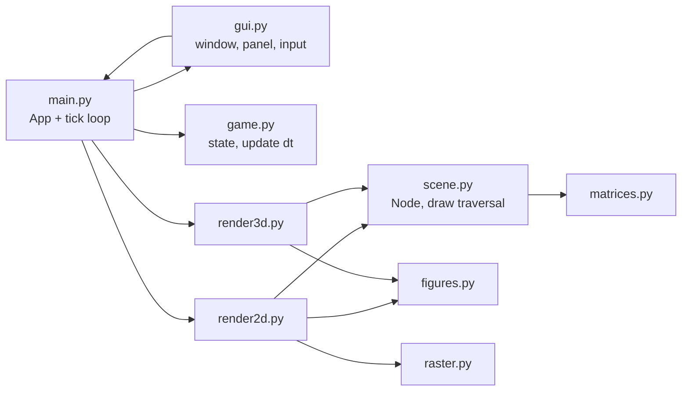
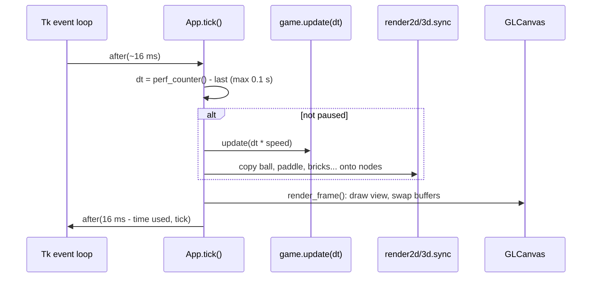
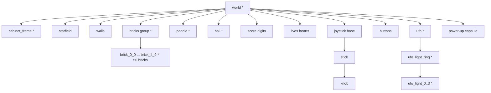

# How the engine works

This explains the parts every other module builds on: the matrices, the scene graph,
the animation loop and the GUI (Member 1). Read it before the Q&A. Every member
should be able to explain one function from each file.

## The 30-second version

> Every object is a **Node** in a **scene graph**. A node stores its figure in its own
> model coordinates (centred on the origin) and a **local transform** `T · R · S`.
> Its **world matrix** is `world(parent) · local(node)`, so children follow their
> parents. All matrices are **our own** 3×3 / 4×4 functions in `matrices.py`. OpenGL only
> gets the finished matrix through `glMultMatrixf`. A Tkinter `after()` loop runs about
> 60 times a second. It measures `dt`, lets `game.py` move the numbers, copies them onto
> the nodes and draws the 2D or 3D view into a double-buffered OpenGL canvas inside the Tk window.

## Files and who calls whom



| File | Owner | Job |
|---|---|---|
| `main.py` | M1 | Creates everything, runs the frame loop, holds pause / speed / view / selection |
| `matrices.py` | M1 | `identity3 translate2 scale2 rotate2 mul apply2 compose inverse2`, `identity4 translate3 scale3 rot_x rot_y rot_z apply3`, `to_gl` |
| `scene.py` | M1 | `Node` (`local`, `world`, `add`, `find`, `all_nodes`), `draw` traversal |
| `gui.py` | M1 | OpenGL canvas, control panel, status bar, matrix panel, keyboard and mouse |
| `test_graphics.py` | M1 + all | Unit tests, `python -m unittest` |
| `figures.py` | M2 / M4 | Vertex lists (2D) and vertex + face tables (3D) |
| `raster.py`, `render2d.py` | M2 | Course algorithms, drawing the 2D scene, click-to-select |
| `game.py`, `persist.py` | M3 | Game rules (no OpenGL), save / load |
| `render3d.py` | M4 | Perspective, lighting, camera, 3D drawing |

**Rule that keeps the parts independent:** `game.py` only holds numbers in world units
and never calls OpenGL. The renderers only *read* the game. That is why the same game
shows up in both the 2D and the 3D view.

## One frame, step by step (`main.py`)



* **Timer-based, no busy-wait.** `after()` asks Tk to call `tick` again later. Between frames
  Tk is free to handle the mouse and keyboard. There is no `sleep()` and no `while True`.
* **`dt` makes speed independent of the frame rate.** Movement is `velocity × dt`, so the
  ball covers the same distance per second at 30 or at 60 FPS. The speed slider just
  multiplies `dt`. Pause means we skip `update` but still draw, so the camera works while paused.
* **`dt` is capped at 0.1 s.** If the window freezes (dragging it, a dialog), the ball
  does not jump through a wall on the next frame.
* **Double buffering.** We draw into the hidden back buffer. `tkSwapBuffers()` shows the
  finished picture in one go, so it never flickers.
* **The `try / finally` in `tick`** always schedules the next frame, so one bad frame
  shows an error in the status bar instead of freezing the animation.

## Matrices (`matrices.py`)

Conventions:

* A matrix is a list of rows (`M[row][col]`). Points are column vectors: `p' = M · p`.
* **Homogeneous coordinates.** A 2D point `(x, y)` is used as `(x, y, 1)`, which is why a
  translation can be a matrix:

```
            | 1 0 tx |   | x |   | x + tx |
T(tx,ty) =  | 0 1 ty | · | y | = | y + ty |
            | 0 0 1  |   | 1 |   |   1    |

         | cos θ  -sin θ  0 |              | sx 0  0 |
R(θ)  =  | sin θ   cos θ  0 |    S(sx,sy) = | 0  sy 0 |
         |   0       0    1 |              | 0  0  1 |
```

* **`mul(A, B)`**: entry `(i, j)` = row `i` of A · column `j` of B. Order matters: `A · B`
  applies **B first**.
* **`compose(T, R, S)` = `T · R · S`**, read right to left: *scale, then rotate, then move*.
  Worked example (it is also a unit test): the point `(1, 0)` under `T(5,0) · R(90°) · S(2,2)`
  goes `(1,0) → S → (2,0) → R → (0,2) → T → (5,2)`.
* **Why `T·R·S` and not `R·T`?** With `T` first and `R` second (`R · T`), the object
  is moved and then swung around the origin, so it **orbits**. We use exactly that on
  purpose for orbiting children: the UFO's light ring is rotated, and each light sits at
  `T(r, 0)` inside it.
* **`inverse2`** undoes a 2D transform (1/det formula for the 2×2 part, then undo the
  translation). M2 uses it for click-to-select: it takes a mouse point in world
  coordinates back into the figure's model coordinates.
* **`to_gl(M)`**: `glMultMatrixf` wants 16 floats in **column-major** order, so we read our
  row-major matrix column by column. A 2D 3×3 is first embedded in 4×4 (translation goes
  to the 4th column, z unchanged). `to_gl(translate3(1,2,3))` has 1, 2, 3 at indices 12, 13, 14.
* **No `glTranslatef / glRotatef / glScalef` on objects.** OpenGL matrix calls are only
  used for the camera and projection (`glOrtho`, `gluPerspective`, `gluLookAt`).

## Scene graph (`scene.py`)

```python
class Node:
    name, figure, color, dim (2 or 3), visible, parent, children
    tx, ty, tz, angle, rx, ry, rz, sx, sy, sz      # local transform (degrees)
    def local(self):  T · R · S        (2D: 3x3,  3D: T · Rz · Ry · Rx · S, 4x4)
    def world(self):  parent.world() · local()     (root: just local())
    def add(child), find(name), all_nodes(), depth()
```

**The key rule:** `world(node) = world(parent) · local(node)`. Change a parent and every
child changes with it. The unit test `test_child_follows_parent` checks this: moving the
UFO by (4, -1) moves its light by exactly (4, -1).

The 2D scene graph (planned final version; the starred nodes are already in the placeholder):



Transformation plan for the UFO light (what the hierarchy computes for us):

```
world(light_i) = world(ufo) · local(ring) · local(light_i)
               = T(ufo) · R(heading)   ·   R(ω t)     ·   T(r cos 90°i, r sin 90°i)
```

**Draw traversal** (`scene.draw`): depth-first, parent before children. For each visible
node with a figure:

```
glPushMatrix()                      # save the camera matrix
glMultMatrixf(to_gl(world))         # camera · world(node)
draw_figure(node)                   # vertices in MODEL coordinates only
glPopMatrix()                       # restore the camera matrix
```

A hidden node skips its whole subtree. The traversal passes the parent's world matrix down,
so each node needs one multiplication (`parent_world · local`) instead of rebuilding the
chain up to the root. The result is the same as `node.world()`, just faster.

## GUI (`gui.py`)

```
+--------------------------------+------------------------+
|                                | Simulation             |  Play/Pause, Reset, Speed, 2D/3D
|        OpenGL canvas           | Selected object        |  Object, Size, Rotation, Colour, Visible
|        (pyopengltk)            | [Game tuning|Camera]   |  ball speed, UFO orbit, paddle | yaw, pitch, distance
|                                | World matrix           |  local and world of the selection
+--------------------------------+------------------------+
| help line (always visible)                              |
| Time | FPS | View | Selected | messages                 |
+---------------------------------------------------------+
```

| Control | What it changes |
|---|---|
| Play/Pause, Space | `App.paused`, so `update` is skipped |
| Reset, R | `game.reset()`, both scene graphs rebuilt, time back to 0 |
| Speed slider | `App.speed`, which multiplies `dt` |
| 2D / 3D, V | `App.view`, so the canvas draws the other scene graph; the selection is kept by name |
| Object dropdown | `App.selected`, filled from `scene.all_nodes()` and indented by `depth()` |
| Size | `node.sx = node.sy (= node.sz)`, the **S** of the node's `T·R·S` |
| Rotation | `node.angle` (2D) or `node.ry` (3D), the **R** of `T·R·S` |
| Colour | `node.color` through `tkinter.colorchooser` (a group colours its subtree) |
| Visible | `node.visible`, which hides the subtree |
| Game tuning | `game.ball_speed`, `game.ufo_orbit_speed`, `game.paddle_width` |
| Camera sliders | `CameraControls.yaw / pitch / distance`, which `render3d` reads every frame |
| Matrix panel | shows `node.local()` and `node.world()` 5 times a second |
| Click (2D) | `render2d.pick` → `App.select` (the dropdown follows) |
| Drag / wheel (3D) | `render3d.on_drag / on_wheel` → `camera.set(...)` (the sliders follow) |
| Left / Right, M | `game.paddle_input`, `game.toggle_attract()` |

**"The program never crashes":**

1. Sliders cannot leave their range. Typed numbers are clamped (`clamp`, `parse_number`).
2. Entry boxes use a Tk `validatecommand` (`is_partial_number`), so letters are refused as you type.
3. Every callback is wrapped by `safe()`. An exception becomes a red status-bar message.
   `root.report_callback_exception` catches anything else, and `tick` always schedules
   the next frame.
4. Keyboard shortcuts are ignored while you type in an entry box, so typing "r" does not reset.

## Interfaces the other members implement

```python
# render2d.py (M2)
build_scene() -> Node            sync(root, game, dt)
draw(root, width, height, selected)
pick(root, px, py, width, height) -> Node or None

# render3d.py (M4)
build_scene() -> Node(dim=3)     sync(root, game, dt)
draw(root, width, height, camera, selected)
on_drag(camera, dx, dy)          on_wheel(camera, steps)
#   camera.yaw / camera.pitch / camera.distance, camera.set(yaw=, pitch=, distance=)

# game.py (M3) - no OpenGL
Game(): update(dt), reset(), toggle_attract()
        ball_speed, ufo_orbit_speed, paddle_width, paddle_input
```

Each renderer sets **all** the OpenGL state it needs at the start of `draw` (viewport,
projection, depth test, lighting), so switching views never leaks state from one to the other.

## Tests

Run from `code/`: `python -m unittest -v`. Member 1's tests:

* `mul` matches a hand-worked 3×3 product
* `rotate2(90°)` maps (1, 0) to (0, 1)
* `T·R·S` order: (1, 0) → (5, 2)
* `inverse2(M) · M = I`, and a zero scale is refused
* `to_gl(translate3(1, 2, 3))` puts 1, 2, 3 at indices 12, 13, 14, and a 3×3 is embedded correctly
* `rot_y(90°)` maps z to x
* child follows parent (2D and 3D), child orbits a rotating parent, root world = local
* `find` / `all_nodes` order, mixing 2D and 3D nodes is refused
* GUI validation: partial numbers, clamping, rejecting `''`, `'-'`, `nan`, `inf`, angle wrapping

GitHub Actions runs the same tests on Windows for every push and pull request.
